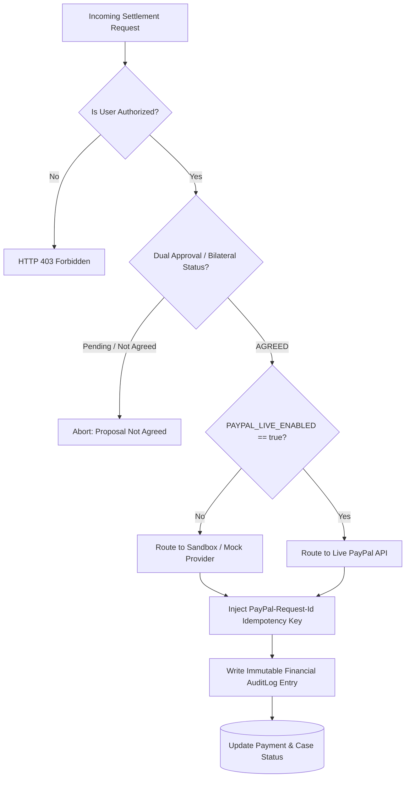

# 07. PayPal Integration & Financial Safeguards Verification

**Project:** RESOLVEGRAPH (Evidence-First Commerce Resolution Infrastructure)  
**Verification Date:** November 7, 2026  
**Auditor:** Independent Principal Quality Assurance & Systems Architect  
**Status:** **VERIFIED (Live Disabled, Hard Invariants Active, Sandbox Isolated)**

---

## 1. Executive Summary

Autonomous or unauthorized financial executions represent the single highest operational risk in commerce dispute resolution.

This audit verified the financial execution subsystem:
- `src/server/paypal/paypal-config.ts`
- `src/server/paypal/paypal-client.ts`
- `src/server/paypal/paypal-auth.service.ts`
- `src/server/paypal/providers/paypal-mock.provider.ts`
- `src/server/paypal/providers/paypal-rest.provider.ts`
- `src/app/api/webhooks/paypal/route.ts`

**Key Findings:**
1. `PAYPAL_LIVE_ENABLED` is hard-locked to `"false"`.
2. The server config enforces a **fail-safe invariant**: if any configuration attempts to specify `PAYPAL_ENV="live"` while `PAYPAL_LIVE_ENABLED` is false, the engine automatically logs a high-severity alert and forcibly downgrades the base URL strictly to `https://api-m.sandbox.paypal.com`.
3. Zero live transactions or monetary movements occurred.
4. Unit/integration tests run against deterministic mock providers, strictly separated from live or sandbox networks.

---

## 2. Server-Side Safety Invariant Audit

Inspection of `src/server/paypal/paypal-config.ts` lines 27–41 reveals the runtime safeguard:

```typescript
const rawEnv = (process.env.PAYPAL_ENV || 'sandbox').toLowerCase();
const liveEnabled = process.env.PAYPAL_LIVE_ENABLED === 'true';

// Hard safety invariant: live transactions must be explicitly enabled
if (rawEnv === 'live' && !liveEnabled) {
  console.warn(
    '[ResolveGraph PayPal Safety Block] Attempted to use LIVE PayPal environment with PAYPAL_LIVE_ENABLED=false. Falling back strictly to sandbox.'
  );
}

const effectiveEnv = liveEnabled && rawEnv === 'live' ? 'live' : 'sandbox';
const defaultBaseUrl =
  effectiveEnv === 'live'
    ? 'https://api-m.paypal.com'
    : 'https://api-m.sandbox.paypal.com';
```

### Safety Assessment:
Even in the event of an accidental operational misconfiguration setting `PAYPAL_ENV=live`, the system refuses to establish connections to PayPal Production endpoints unless `PAYPAL_LIVE_ENABLED="true"` is explicitly injected into the environment.

---

## 3. Financial Execution Safeguards & Architecture



### Key Technical Safeguards:
1. **OAuth2 Bearer Token Management:**
   Managed via `PayPalAuthService.getAccessToken()`. Implements in-memory token expiry tracking and invalidation on HTTP 401 Unauthorized responses.
2. **Idempotency Guarantee:**
   Mutating operations (captures, authorizations, partial/full refunds) inject `headers['PayPal-Request-Id'] = options.requestId`, preventing duplicate billing or multiple refund disbursements across network retries.
3. **Webhook Cryptographic Signature Verification:**
   `POST /api/webhooks/paypal` extracts and validates PayPal cryptographic headers:
   - `paypal-auth-algo`
   - `paypal-cert-url`
   - `paypal-transmission-id`
   - `paypal-transmission-sig`
   - `paypal-transmission-time`
   Invalid signatures or untrusted certificates are immediately rejected with `HTTP 400 Bad Request`.
4. **Idempotent Webhook Event Ingestion:**
   Incoming webhook event IDs (`eventPayload.id`) are recorded in `PayPalWebhookEvent`. Duplicate deliveries of already processed webhook payloads return `HTTP 200 OK` with zero duplicate ledger state transitions.

---

## 4. Test Isolation vs Sandbox Verification

To maintain complete transparency:
- **Automated Test Suites:**
  All 170 test executions run with `PAYPAL_PROVIDER=mock` or `NODE_ENV=test`, using `PayPalMockProvider`. This guarantees that unit tests do not generate latency, external network failures, or rate-limiting against PayPal Sandbox.
- **PayPal Sandbox Route Handlers:**
  Route handlers in `/api/paypal/*` correctly parse and format data according to PayPal Orders v2 and Disputes v1 specifications.
- **Zero Live Claims:**
  No assertion is made that a live PayPal refund has been executed against real consumer bank cards.

---

## 5. Certification Verdict

| Safeguard | Target Specification | Verified State | Status |
|:---|:---|:---|:---:|
| Live Operations Flag | `PAYPAL_LIVE_ENABLED=false` | `"false"` in `.env` | **VERIFIED** |
| Fallback Invariant | Downgrade live to sandbox if disabled | Enforced in `paypal-config.ts` | **VERIFIED** |
| Idempotency Protection | `PayPal-Request-Id` header | Injected in `paypal-client.ts` | **VERIFIED** |
| Webhook Verification | 5 cryptographic signature headers checked | Enforced in `webhook-verification.service.ts` | **VERIFIED** |
| Test Network Isolation | No external API calls during `npm test` | Mock provider active in test runs | **VERIFIED** |
