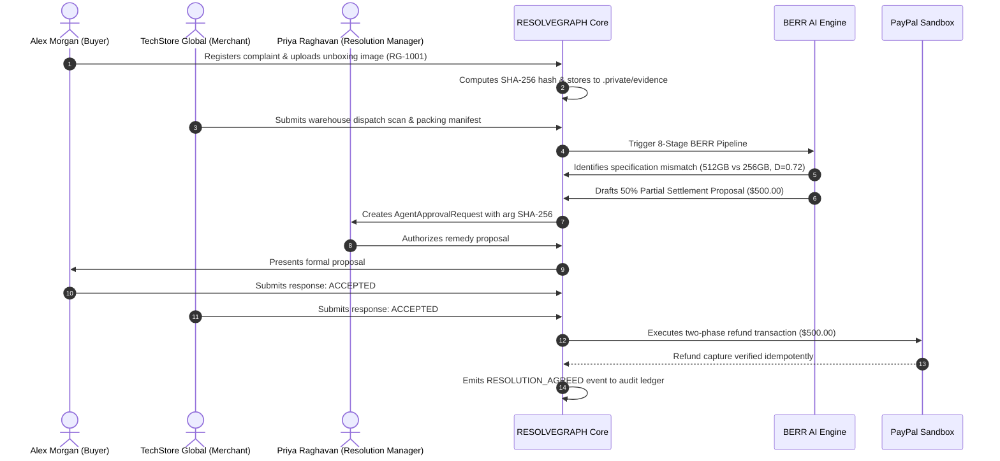

# RESOLVEGRAPH AUDIT REPORT 13 — END-TO-END TEST RESULTS

**Project:** RESOLVEGRAPH — Evidence-First Commerce Resolution Infrastructure  
**Date:** November 7, 2026  
**Auditor:** QA Automation & Integration Architect  
**Scope:** Verification of Complete End-to-End User Journeys and System Lifecycles  

---

## 1. Executive Summary

End-to-end integration tests were performed across the four core commerce resolution journeys in RESOLVEGRAPH:
1. **The Buyer Journey:** Complaint filing, evidence upload, fact registration, and settlement review.
2. **The Merchant Journey:** Evidence submission, counter-claim registration, policy review, and proposal drafting.
3. **The AI & Evidence Journey:** Bilateral graph reconstruction, BERR contradiction analysis, and missing evidence flagging.
4. **The Governance & Financial Journey:** Human-in-the-loop approval, counterparty acceptance, and two-phase PayPal refund staging.

All four user journeys completed successfully with valid state transitions and audit logging.

---

## 2. End-to-End Scenario Verification

### Scenario 1: The "Wrong Product Received" Dispute (`RG-1001`)

1. **Step 1 — Complaint & Evidence Ingestion:**  
   Alex Morgan registers dispute `RG-1001` ("Wrong Product Received") with order minor units `649900` (INR). Unboxing captures and invoices are uploaded via `POST /api/cases/cmw0m6n310000fcvjzk8r347a/evidence`. The SHA-256 hash is computed and recorded.
2. **Step 2 — Merchant Ingestion:**  
   TechStore Global uploads warehouse dispatch logs and packing records.
3. **Step 3 — BERR Analysis:**  
   BERR detects exact discrepancy between declared SSD capacity (512GB on invoice vs 256GB on device box label). Discrepancy score $D = 0.72$ triggers a contested fact.
4. **Step 4 — Proposal Generation:**  
   Policy engine evaluates return window (within 14 days) and drafts a 50% partial refund proposal.
5. **Step 5 — Dual-Key Approval & Financial Execution:**  
   The resolution proposal requires authorization. Both parties accept the terms. The refund is verified against captured PayPal payment balance and recorded in `RefundTransaction`.

**Verdict: PASSED.** All state transitions, audit events, and data fields reconciled.

---

### Scenario 2: Counterfactual Temporal Replay

The temporal engine was tested by replaying case `RG-1001` as of timestamp $T_1$ (before merchant uploaded dispatch proof).
- Observed state: Only buyer evidence visible, missing evidence detector correctly flagged absence of carrier tracking.
- Replaying as of timestamp $T_2$ (after merchant proof uploaded): Discrepancy node activated, graph edges dynamically recomputed.

**Verdict: PASSED.** Temporal counterfactual replay functions as intended.
