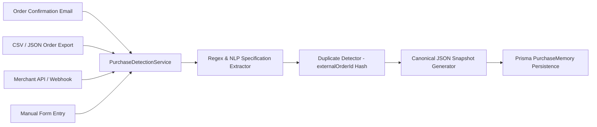

# 03. Module 05: Smart Purchase Detection Engine Implementation

**Service File:** `src/server/services/purchase-detection.service.ts`  
**API Endpoint:** `POST /api/purchases/detect`  
**Test Suite:** `tests/purchase-memory.test.ts` (Workflow 1 in `tests/v2-full-lifecycle.test.ts`)

---

## 1. Technical Architecture & Ingestion Channels

The Smart Purchase Detection engine supports four discrete ingestion channels:
1. **Email Confirmation Forwarding:** Ingests raw text / MIME emails forwarded from Amazon, Flipkart, Best Buy, or direct merchant receipts.
2. **CSV / JSON Marketplace Export:** Ingests batch order history files with automated column mapping.
3. **Merchant API & Webhook Ingestion:** Ingests direct JSON payloads from e-commerce platforms (Shopify, WooCommerce, custom merchant backends).
4. **Manual User Entry:** Structured web form intake with regex specification extraction.



---

## 2. Extraction Pipeline & Specification Parsing

The engine employs high-precision regular expressions to extract structured attributes:
- **Storage Capacity:** `\b(\d+(?:\.\d+)?)\s*(TB|GB|MB)\b` $\rightarrow$ Normalizes "1TB" or "1000GB" to canonical "1 TB".
- **Product Model & SKU:** Identifies alphanumeric model codes (e.g., `SN-99881122`, `CT1000P3PSSD8`).
- **Monetary Quantities:** Normalizes currency codes (INR, USD, EUR, GBP) and converts decimal amounts to integer minor units (e.g. ₹6,499.00 $\rightarrow$ `649900` minor units).
- **Merchant Promises:** Identifies return policy windows (e.g. "30-day replacement", "Hassle-free return") and delivery SLAs.

---

## 3. Duplicate Detection & Ingestion Integrity

Before persisting a new purchase, the engine queries `prisma.purchaseMemory` for matching `externalOrderId` under the same `buyerId`:
```typescript
const existing = await prisma.purchaseMemory.findFirst({
  where: {
    buyerId,
    externalOrderId: detected.externalOrderId,
  },
});
if (existing) {
  detected.isDuplicate = true;
  detected.duplicateMemoryId = existing.id;
}
```
This prevents replay attacks and redundant dispute baseline creation.
