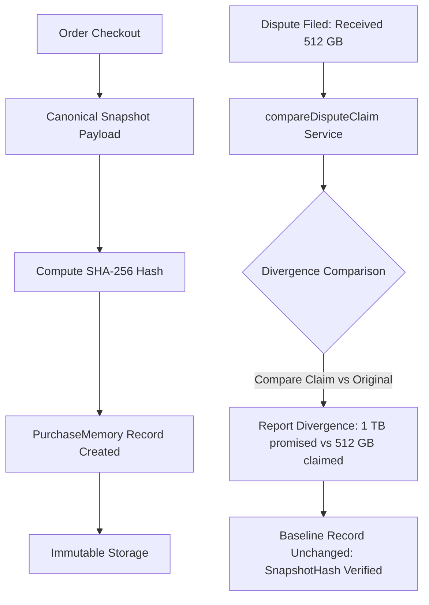

# 04. Module 06: Purchase Memory Engine Implementation

**Service File:** `src/server/services/purchase-memory.service.ts`  
**API Endpoints:** `GET /api/purchases/memory`, `GET /api/purchases/[id]`, `POST /api/purchases/[id]/compare-dispute`  
**Test Suite:** `tests/purchase-memory.test.ts`

---

## 1. Core Principle: Immutable Baseline Protection

In conventional commerce platforms, when a customer opens a dispute claiming they received a different item, the complaint often mutates or obscures the original checkout record in dispute tracking systems.
**Purchase Memory guarantees cryptographic immutability.**

The baseline purchase promise is hashed upon creation:
$$\text{SnapshotHash} = \text{SHA-256}(\text{CanonicalPayload})$$



---

## 2. Divergence Comparison Analysis

When a buyer submits a complaint statement such as *"Buyer received 512 GB SSD instead of 1 TB"*, `PurchaseMemoryService.compareDisputeClaim` performs an automated semantic comparison:
1. Loads original specifications: `{ storage_capacity: "1 TB", model: "UltraPro NVMe" }`.
2. Extracts claimed discrepancy from the dispute statement: `512 GB`.
3. Detects divergence: `1 TB != 512 GB`.
4. Outputs structured divergence finding:
```json
{
  "divergencesFound": [
    {
      "specKey": "storage_capacity",
      "originalPromise": "1 TB",
      "claimedDiscrepancy": "512 GB",
      "explanation": "Buyer reports receiving 512 GB, but original immutable purchase memory records 1 TB."
    }
  ],
  "isMemoryPreserved": true
}
```

Automated test `tests/purchase-memory.test.ts` proves that after divergence comparison, `snapshotHash` is byte-for-byte identical to its creation checksum.
