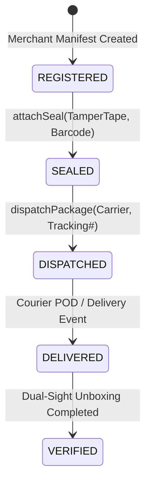

# 05. Module 08: Package Passport & Physical Seals Implementation

**Service File:** `src/server/services/package-passport.service.ts`  
**API Endpoints:** `POST /api/packages`, `POST /api/packages/[id]/seal`, `POST /api/packages/[id]/dispatch`, `GET /api/packages/verify/[token]`  
**Test Suite:** `tests/package-passport.test.ts`

---

## 1. Package Passport State Machine

Each outbound shipment is tracked through an immutable state machine:
$$\text{REGISTERED} \xrightarrow{\text{Seal Attached}} \text{SEALED} \xrightarrow{\text{Carrier Handover}} \text{DISPATCHED} \xrightarrow{\text{Delivery Event}} \text{DELIVERED} \xrightarrow{\text{Unboxing Verified}} \text{VERIFIED}$$



---

## 2. Physical Tamper-Evident Seals & Integrity Hashing

When packing goods at the fulfillment warehouse, the merchant operator attaches a physical tamper-evident seal (e.g. numbered tape, security hologram, RFID tag):
```typescript
const updatedIntegrity = createHash("sha256")
  .update(`${pkg.integrityHash}:${seal.sealNumber}:${seal.sealType}`)
  .digest("hex");
```
Every attached seal updates the package's cumulative cryptographic hash, establishing an immutable chain of custody before dispatch.

---

## 3. Privacy-Safe QR Verification Protocol

Each package generates a cryptographically signed QR token:
```typescript
const signature = createHmac("sha256", secret).update(`${packageId}:${timestamp}`).digest("hex");
const qrToken = `${packageId}.${timestamp}.${signature}`;
```

When scanned by a buyer or courier handler (`GET /api/packages/verify/[token]`), the system returns:
- Package status and dispatch timestamps
- Item list and declared capacities
- Seal numbers and verification status
- **Zero Buyer PII Exposure:** Buyer street address, phone number, and financial payment IDs are completely omitted from the public verification payload.
