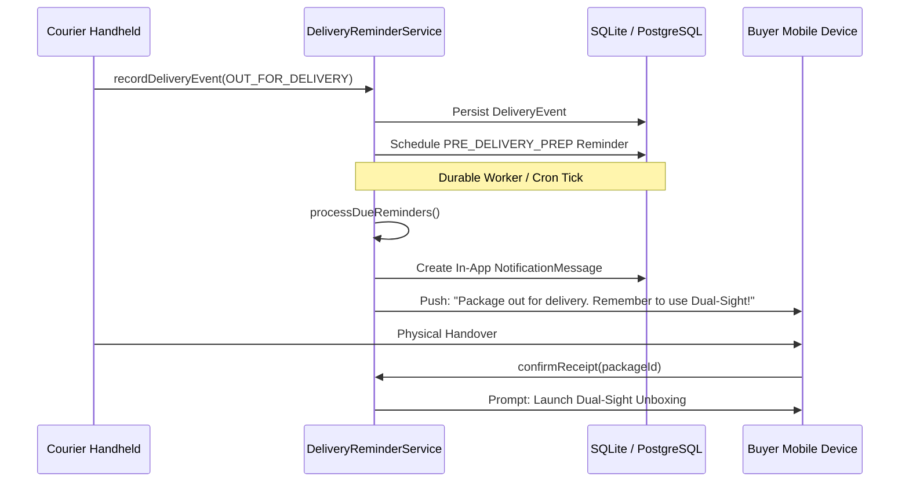

# 06. Module 09: Smart Delivery Tracking & Unboxing Reminders

**Service File:** `src/server/services/delivery-reminder.service.ts`  
**API Endpoints:** `POST /api/delivery/events`, `POST /api/delivery/confirm-receipt`, `GET /api/notifications`  
**Test Suite:** `tests/delivery-reminder.test.ts`

---

## 1. Technical Objectives

Module 09 bridges carrier logistics and post-delivery evidence readiness:
1. Ingests carrier transit checkpoints (`IN_TRANSIT`, `OUT_FOR_DELIVERY`, `DELIVERED`).
2. Clearly distinguishes between confirmed courier handoffs and buyer unboxing verification.
3. Automatically schedules pre-delivery preparation notifications to prime buyers before breaking seals.
4. Provides receipt confirmation that immediately prompts for Dual-Sight unboxing video capture.

---

## 2. Ingestion & Scheduled Job Processing



---

## 3. Data Integrity & Idempotency

- **Deduplication:** Scheduled reminders enforce a unique constraint on `[packageId, reminderType]`, preventing spam notifications.
- **Due Processing:** `processDueReminders` executes idempotently:
```typescript
const due = await prisma.deliveryReminder.findMany({
  where: { status: "SCHEDULED", scheduledFor: { lte: now } },
});
for (const r of due) {
  await prisma.notificationMessage.create({ ... });
  await prisma.deliveryReminder.update({ where: { id: r.id }, data: { status: "SENT" } });
}
```
