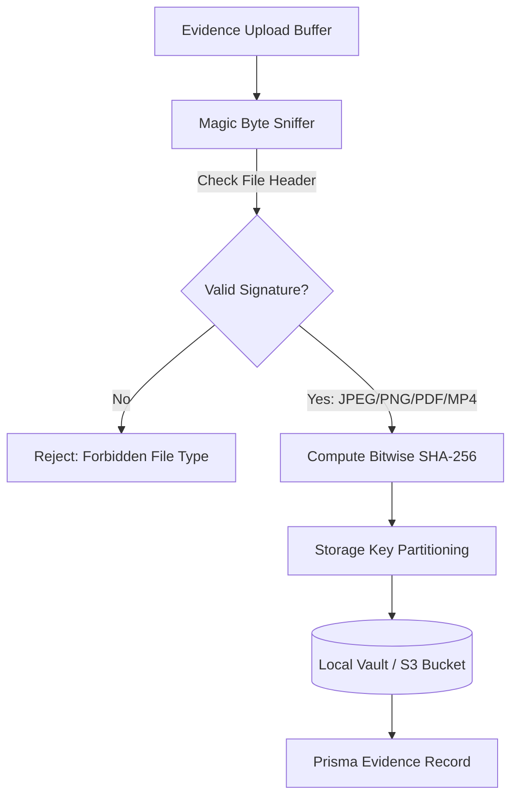

# 08. Module 11: Evidence Vault Storage & Integrity Architecture

**Service Files:** `src/server/storage/local-evidence-storage.ts`, `src/server/storage/s3-evidence-storage.ts`  
**API Endpoints:** `GET /api/evidence`, `GET /api/evidence/[id]/download`  
**Test Suite:** `tests/storage.test.ts`

---

## 1. Multi-Tier Storage Abstraction

ResolveGraph provides pluggable, secure evidence storage across local development and enterprise cloud environments:
1. **Local Content-Addressable Storage:** For development, tests, and air-gapped deployments. Files are organized by 2-level SHA-256 directory trees (`vault/ab/cd/<hash>-<filename>`).
2. **Enterprise S3 / Cloudflare R2 Storage:** Production cloud storage with TLS encryption, signed download URLs, and server-side encryption (`AES256` / `aws:kms`).

---

## 2. Security & Tamper Detection Invariants

- **Magic Byte Validation:** Inspects raw binary headers (e.g. `\xFF\xD8\xFF` for JPEG, `\x89PNG` for PNG, `%PDF` for PDF, `ftyp` for MP4) before persisting, completely rejecting extension spoofing.
- **Cryptographic Hash Immutability:** The SHA-256 checksum is stored permanently in `Evidence.sha256`. Any modification to the underlying file results in an instant integrity alert.
- **Strict Role-Based Visibility:**
  - `SHARED_WITH_PARTICIPANTS`: Visible to buyer, merchant, and resolution manager.
  - `INTERNAL`: Restricted strictly to Resolution Managers and Platform Admins.
