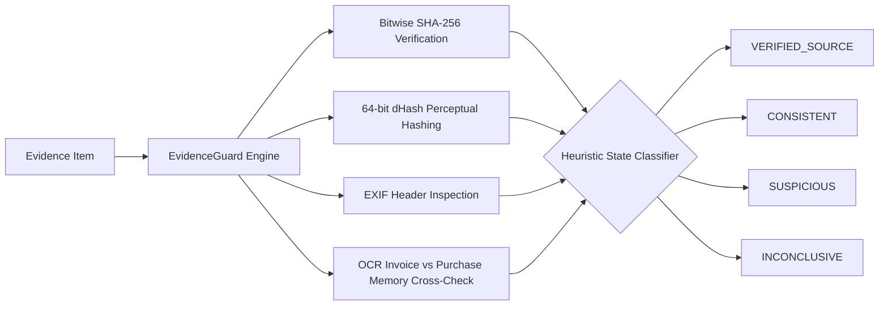

# 09. Module 12: EvidenceGuard AI Forensics Engine Implementation

**Service File:** `src/server/services/evidenceguard.service.ts`  
**API Endpoint:** `POST /api/evidence/[id]/analyze`  
**Test Suite:** `tests/evidenceguard.test.ts`

---

## 1. Multi-Signal Forensic Analysis

EvidenceGuard evaluates evidence authenticity across four orthogonal forensic vectors:
1. **Cryptographic Checksum Verification:** Validates uploaded binary buffer against registered SHA-256 checksum.
2. **Perceptual Image Hashing (dHash):** Computes a 64-bit gradient difference hash from image luminance gradients to detect duplicate submissions across cases.
3. **EXIF & Camera Metadata Inspection:** Verifies original camera hardware tags and flags missing headers or known editing software (e.g. Photoshop).
4. **Document / Invoice Cross-Checking:** Cross-references OCR extracted text against immutable Purchase Memory specifications.



---

## 2. Standardized Assessment States

EvidenceGuard emits one of four standardized forensic states:
- **`VERIFIED_SOURCE`**: Cryptographic integrity verified, authentic camera EXIF metadata present, no duplicate hashes.
- **`CONSISTENT`**: Cryptographic checksum matches; file structure is consistent with genuine user capture.
- **`SUSPICIOUS`**: Perceptual duplicate detected from a prior case, altered SHA-256 hash, or invoice capacity diverges from Purchase Memory.
- **`INCONCLUSIVE`**: File lacks EXIF or metadata headers; human review recommended.

---

## 3. Duplicate Image Detection via Hamming Distance

```typescript
public static hammingDistance(hash1: string, hash2: string): number {
  let diff = 0;
  for (let i = 0; i < Math.min(hash1.length, hash2.length); i++) {
    if (hash1[i] !== hash2[i]) diff++;
  }
  return diff;
}
```
If the Hamming distance between two perceptual hashes is $\le 4$, the image is flagged as a perceptual duplicate, preventing buyers from recycling photos across disputes.
