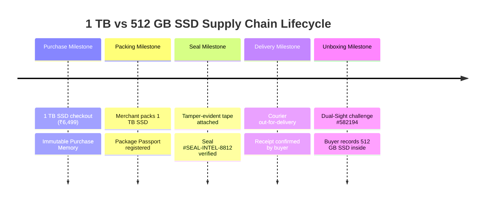

# 10. Module 13: Multimodal Case Intelligence & Timeline Divergence

**Service File:** `src/server/ai/intelligence/lifecycle-intelligence.service.ts`  
**API Endpoint:** `GET /api/cases/[caseId]/lifecycle`  
**Test Suite:** `tests/lifecycle-intelligence.test.ts`

---

## 1. Unified Lifecycle Timeline Aggregation

Disputes rarely originate from a single document; they stem from divergences along a supply-chain timeline.
Module 13 aggregates multimodal facts across five discrete milestones:
1. **Purchase Milestone:** Listing title, specifications (e.g. 1 TB SSD), checkout date, order ID.
2. **Packing Milestone:** Merchant package passport, manifest items, serial numbers, declared condition.
3. **Seal Milestone:** Tamper-evident seal number, tape type, fulfillment operator ID.
4. **Delivery Milestone:** Carrier checkpoints, time of delivery, van scans.
5. **Unboxing Milestone:** Dual-Sight unboxing challenge code, video recording, buyer dispute statement.



---

## 2. Root Cause Divergence Pinpointing

By analyzing the state of facts across each milestone, the engine automatically pinpoints the exact point where reality diverged from the purchase promise:
```json
{
  "divergenceDetected": true,
  "divergenceMilestone": "UNBOXING",
  "discrepancyType": "PRODUCT_SPECIFICATION_MISMATCH",
  "explanation": "Purchase memory and merchant packing record 1 TB SSD, but unboxing evidence and buyer claim establish 512 GB SSD model was received."
}
```
This enables objective evidence-to-remedy reasoning without requiring human manual re-examination of raw files.
