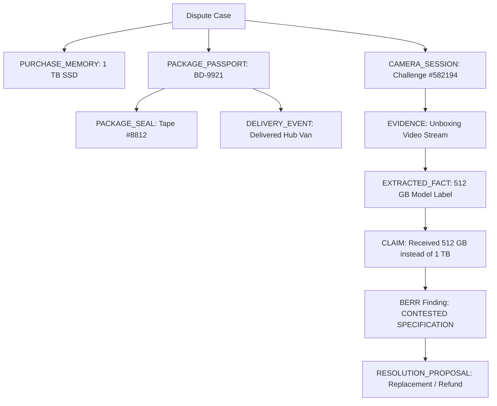

# 11. Module 14: Bilateral Evidence Graph (BEG) v2 Implementation

**Service Files:** `src/server/graph/graph-builder.ts`, `src/server/graph/graph-projection.ts`  
**API Endpoints:** `GET /api/cases/[caseId]/graph`, `POST /api/cases/[caseId]/graph/rebuild`  
**Test Suite:** `tests/beg-and-berr-v2.test.ts`

---

## 1. Graph Expansion & New Node Types

Version 2.0 expands the Bilateral Evidence Graph from a claim-evidence graph into an end-to-end commerce lifecycle graph:
- **`PURCHASE_MEMORY` Node:** Original purchase specifications and cryptographic snapshot hash.
- **`PACKAGE_PASSPORT` Node:** Outbound shipping manifest, tracking number, and carrier identity.
- **`PACKAGE_SEAL` Node:** Physical tamper-evident seals and integrity verification state.
- **`CAMERA_SESSION` Node:** Dual-Sight unboxing challenge verification session and stream hashes.
- **`DELIVERY_EVENT` Node:** Carrier transit checkpoints and delivery handoff timestamps.

---

## 2. 3D WebGL Visualization & Projection

The graph projection service calculates hierarchical tier layers and spring-physics coordinates for Three.js / React Three Fiber rendering:
- **Tier 0:** Case Root
- **Tier 1:** Claims & Purchase Memory
- **Tier 2:** Evidence & Package Passports
- **Tier 3:** Extracted Facts & Physical Seals
- **Tier 4:** BERR Findings & Camera Sessions
- **Tier 5:** Resolution Proposals & Settlements

Nodes are color-coded by party provenance: **Buyer (Emerald)**, **Merchant (Blue)**, **System Audit (Purple)**, **Neutral (Amber)**.
