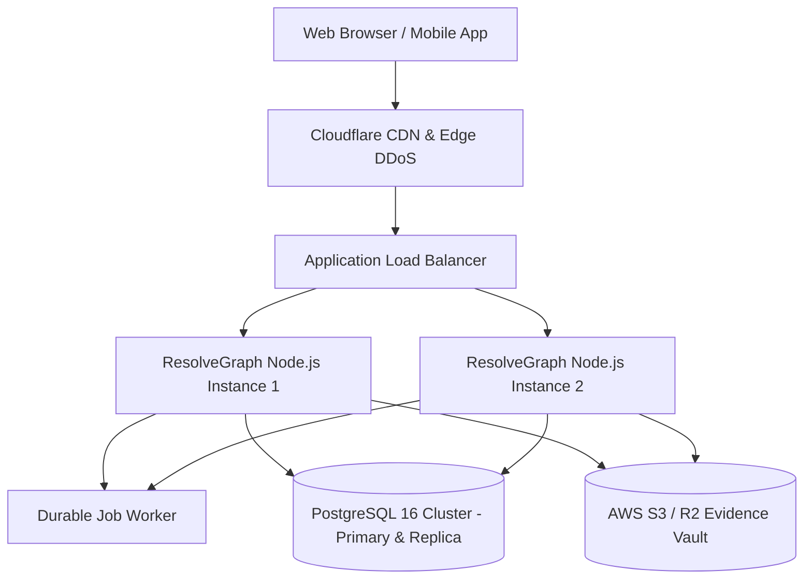

# 21. Production Deployment, Health Monitoring & SRE Operations

**Health Check Endpoint:** `GET /api/health`  
**Runtime Engine:** Next.js 16.4.4 App Router / Node.js 20+  
**Database:** SQLite / PostgreSQL 16+

---

## 1. Production Deployment Topology

---

## 2. Health Monitoring & Observability (`GET /api/health`)

The `/api/health` endpoint evaluates operational readiness in real time:
- **Database Connectivity:** Executes lightweight `SELECT 1` via Prisma.
- **Storage Read/Write:** Verifies local vault or S3 bucket write access.
- **Payment Gateway Status:** Reports PayPal Sandbox connectivity and live fund locks.
- **Worker Heartbeat:** Validates active lease timestamp on the durable worker queue.
