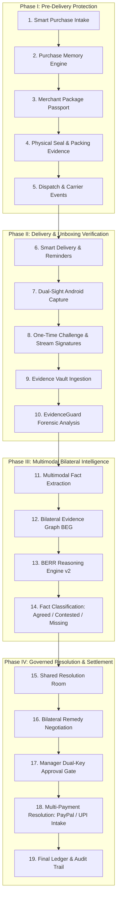

# 02. Architecture & Dependency Implementation Plan

**Project:** RESOLVEGRAPH Version 2.0  
**Updated Project Title:** Preventive Commerce Protection & Evidence-Based Payment Resolution Infrastructure  
**Auditor / Architect:** Principal Software Architect & Lead Full-Stack Engineer  
**Date:** November 7, 2026  
**Status:** **ARCHITECTURAL PLAN APPROVED**

---

## 1. System Architecture & Lifecycle Overview

RESOLVEGRAPH Version 2.0 establishes a continuous, cryptographically bound commerce lifecycle connecting the pre-purchase promise to post-delivery unboxing and financial resolution:

---

## 2. Relational Database Expansion Strategy

To support Version 2.0 entities without breaking existing models or mutating historical `dev.db` records, the Prisma schema will be extended with the following non-destructive models:

### 1. Purchase Memory Subsystem
- `PurchaseMemory`: Root container for the immutable purchase promise linked to `CommerceOrder` and `User` (Buyer).
- `PurchaseSpecification`: Structured technical specifications (e.g., storage capacity 1TB, model, color, dimensions).
- `PurchasePromise`: Merchant commitments (delivery SLA, return window, warranty duration, refund conditions).
- `PurchaseSnapshot`: Cryptographic SHA-256 snapshot of listing HTML/JSON to detect seller catalog tampering.

### 2. Package Passport Subsystem
- `PackagePassport`: Unique package passport entity with secure QR token, packing status, and carrier tracking.
- `PackageItem`: Specific items and serial numbers packed into the physical shipment.
- `PackageSeal`: Physical tamper-evident seal identifiers, seal types (numbered tape, holographic sticker, security barcode).
- `PackageEvent`: Immutable log of package state changes (`PACKING_STARTED`, `SEAL_APPLIED`, `DISPATCHED`, `IN_TRANSIT`, `DELIVERED`).

### 3. Delivery & Reminder Subsystem
- `DeliveryEvent`: Carrier and customer-reported transit checkpoints (`ORDER_CONFIRMED`, `DISPATCHED`, `OUT_FOR_DELIVERY`, `DELIVERED`).
- `DeliveryReminder`: Scheduled notification triggers for pre-delivery inspection and unboxing preparation.

### 4. Dual-Sight Capture & Session Subsystem
- `CameraSession`: Verification session record linked to buyer, order, and package.
- `CaptureChallenge`: Cryptographically random, short-lived visual/audio challenge to guarantee live temporal authenticity.
- `CameraStreamRecord`: Metadata for rear-camera recording and optional front-camera recording.

### 5. EvidenceGuard Forensic Subsystem
- `EvidenceAnalysisResult`: Multi-signal forensic assessment results (`VERIFIED SOURCE`, `CONSISTENT`, `SUSPICIOUS`, `INCONCLUSIVE`).
- `ForensicSignal`: Detected indicators (EXIF presence, perceptual image hash, video frame sampling, OCR cross-match).

### 6. Shared Resolution & Multi-Payment Subsystem
- `SharedRoomMessage`: Bilateral messages between buyer and merchant with permission-gated evidence attachments.
- `PaymentComplaint`: Unified complaint intake supporting PayPal disputes and UPI transactions (PhonePe, GPay, Paytm, BHIM with UTR/RRN tracking).

---

## 3. 12-Phase Implementation Execution Sequence

```mermaid
flowchart LR
    Ph1[Phase 1: Purchase Memory] --> Ph2[Phase 2: Package Passport]
    Ph2 --> Ph3[Phase 3: Delivery Reminders]
    Ph3 --> Ph4[Phase 4: Dual-Sight Android]
    Ph4 --> Ph5[Phase 5: EvidenceGuard AI]
    Ph5 --> Ph6[Phase 6: Multimodal Intelligence]
    Ph6 --> Ph7[Phase 7: BEG & BERR v2]
    Ph7 --> Ph8[Phase 8: Shared Resolution]
    Ph8 --> Ph9[Phase 9: Multi-Payment & UPI]
    Ph9 --> Ph10[Phase 10: Portal Expansions]
    Ph10 --> Ph11[Phase 11: RECOURSE-BENCH]
    Ph11 --> Ph12[Phase 12: QA & Certification]
```

### Phase Details & Dependencies:

1. **Phase 1: Purchase Memory & Smart Purchase Detection (Modules 05, 06)**
   - Schema updates for `PurchaseMemory`, `PurchaseSpecification`, `PurchasePromise`, `PurchaseSnapshot`.
   - Ingestion service for manual entry, email extraction, and CSV/JSON orders.
   - Acceptance test: 1 TB SSD purchase with immutable specification preservation.
2. **Phase 2: Package Passport System (Module 08)**
   - Schema updates for `PackagePassport`, `PackageItem`, `PackageSeal`, `PackageEvent`.
   - Secure QR generator and signed lookup API.
   - Merchant packing workflow and seal registration UI.
3. **Phase 3: Smart Delivery & Unboxing Reminders (Module 09)**
   - Scheduled reminder engine with duplicate prevention.
   - Delivery event hooks and pre-unboxing reminder notifications.
4. **Phase 4: Dual-Sight Android Mobile Capture (Module 10)**
   - Kotlin/Gradle/CameraX architecture in `mobile/android/resolvegraph-capture/`.
   - Hardware concurrency inspection (concurrent front/rear vs rear-only fallback).
   - One-time challenge download and resumable upload API integration.
5. **Phase 5: EvidenceGuard AI Forensics (Modules 11, 12)**
   - Multi-signal forensic pipeline: EXIF metadata, duplicate/perceptual hashing, video frame sampling, invoice OCR cross-check against Purchase Memory.
   - Four assessment states: `VERIFIED SOURCE`, `CONSISTENT`, `SUSPICIOUS`, `INCONCLUSIVE`.
6. **Phase 6: Multimodal Case Intelligence (Module 13)**
   - Unified fact extraction schema linking evidence to Purchase Memory and Package Passport.
   - Lifecycle divergence detector pinpointing where product specs changed.
7. **Phase 7: Bilateral Evidence Graph & BERR v2 (Modules 14, 15)**
   - BEG extension to connect packages, seals, camera sessions, and delivery events.
   - BERR v2 reasoning engine evaluating purchase spec vs declared vs unboxing evidence.
   - Classification of facts: `AGREED`, `CONTESTED`, `MISSING`, `VERIFIED`.
8. **Phase 8: Shared Resolution Room & Financial Orchestration (Module 16)**
   - Real-time bilateral messaging, missing evidence requests, and remedy counter-offers.
   - State machine integration with existing dual-key manager safeguards.
9. **Phase 9: Multi-Payment Complaint Intake & UPI (Module 07)**
   - Standardized `PaymentProviderAdapter` interface.
   - UPI intake for PhonePe, Google Pay, Paytm, BHIM with UTR/RRN tracking and unauthorized payment alerts.
10. **Phase 10: Buyer, Merchant & Manager Portal Expansions (Modules 02, 03, 04, 01)**
    - Comprehensive UI views: Purchases, Purchase Memory, Package Passports, Delivery, Unboxing Sessions, Shared Resolution Room.
    - Role-based navigation and access controls.
11. **Phase 11: RECOURSE-BENCH 400-Scenario Expansion (Research / Module 15)**
    - Expansion of synthetic evaluation dataset to 400 distinct, reproducible scenarios.
    - Experiments E1 through E5: claim extraction, grounding, contradiction, authenticity, escalation.
12. **Phase 12: Full QA Automation, Integration Testing, and Release Reporting**
    - 10 Playwright/integration E2E scenarios.
    - Unit and API tests for all new models and routes.
    - Delivery of reports `00` through `17` and Version 2.0 release documentation.

---

## 4. Engineering Principles & Safety Guardrails

- **Zero Database Resets:** Schema modifications will be applied additively.
- **Test Database Isolation:** All automated tests will target isolated database fixtures (`$env:DATABASE_URL="file:./test_isolated.db"`), leaving `dev.db` untouched.
- **Financial Safety:** `PAYPAL_LIVE_ENABLED=false` remains strictly enforced. No live banking or UPI operations.
- **AI Honesty:** No fabricated claims of deepfake detection or 0.0% LLM error rates. Uncertainty and provider availability states clearly exposed.
