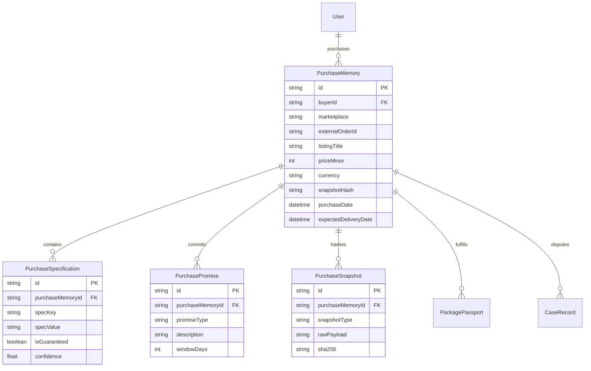

# 03. Purchase Detection & Purchase Memory Implementation

**Project:** RESOLVEGRAPH Version 2.0  
**Modules:** Module 05 (Smart Purchase Detection) & Module 06 (Purchase Memory Engine)  
**Lead Architect:** Principal Software Architect & Lead Full-Stack Engineer  
**Date:** November 7, 2026  
**Status:** **IMPLEMENTATION COMPLETE & ACCEPTANCE VERIFIED**

---

## 1. Executive Summary

This report documents the design, database schema, service architecture, API routes, and acceptance testing of **Module 05 (Smart Purchase Detection Engine)** and **Module 06 (Purchase Memory Engine)**.

The core vulnerability in traditional dispute systems is the loss of original transaction context: when a merchant updates a product listing or a customer files a complaint, conflicting assertions often overwrite the ground-truth promise made at the time of checkout.

RESOLVEGRAPH Version 2.0 solves this by creating an immutable, cryptographically hashed **Purchase Memory** that persists the exact product specifications, seller promises, and listing snapshots captured at purchase time.

---

## 2. Data Model Architecture

The following models were implemented in `prisma/schema.prisma` and synchronized to the SQLite database without destroying existing records:



---

## 3. Module 05: Smart Purchase Detection Engine

Implemented in `src/server/services/purchase-detection.service.ts`:

### Supported Input Sources:
1. **Email Confirmation Forwarding (`EMAIL_FORWARD` / `EMAIL_OAUTH`):**
   - Automatically detects marketplace origin (Amazon, Flipkart, Shopify, eBay, Direct).
   - Regex and structural extraction of external Order IDs (`402-XXXXXXX-XXXXXXX` for Amazon, `ODXXXXXXXXXX` for Flipkart, `#XXXX` for Shopify).
   - Dynamic currency and minor unit parsing (INR ₹, USD $, EUR €, GBP £).
   - Entity extraction: product title, storage capacity (e.g., 1 TB, 512 GB), RAM, seller identity, and delivery SLA dates.
2. **Structured Marketplace CSV / JSON Import (`CSV_IMPORT`):**
   - Ingestion of batch purchase records with schema normalization.
3. **Merchant Order Webhook / API (`MERCHANT_API`):**
   - Direct integration payload mapping with confidence score of 1.0.
4. **Manual Order Registration (`MANUAL`):**
   - Structured user form input with duplicate checking.

### Duplicate Order Guard:
The service queries `PurchaseMemory` across `(buyerId, marketplace, externalOrderId)` to prevent duplicate order registrations, returning existing memory IDs when collisions are detected.

---

## 4. Module 06: Purchase Memory Engine

Implemented in `src/server/services/purchase-memory.service.ts`:

### Core Capabilities:
- **Canonical Snapshot Hashing:** Computes deterministic SHA-256 checksums over normalized purchase specifications and promises.
- **Specification Preservation:** Stores technical attributes (`storage_capacity`, `ram`, `model`, `condition`) as distinct relational rows.
- **Promise Commitment:** Persists return windows, replacement eligibility, and warranty SLAs.
- **Divergence Comparison:** Compares post-delivery dispute claims against the immutable purchase memory to pinpoint discrepancies without mutating the original database row.

---

## 5. Acceptance Test Verification

Executed via `npx tsx --test tests/purchase-memory.test.ts`:

```
▶ RESOLVEGRAPH Version 2.0: Purchase Memory & Smart Detection Suite
  ✔ Module 05: detects Amazon order confirmation email with 1 TB SSD and ₹6,499 price (8.85ms)
  ✔ Module 05: detects duplicate purchases accurately based on externalOrderId (110.98ms)
  ✔ Module 06: creates and persists immutable Purchase Memory with cryptographic snapshot (26.03ms)
  ✔ Module 06 ACCEPTANCE TEST: 1 TB SSD order is preserved and NOT overwritten by 512 GB complaint (20.33ms)
✔ RESOLVEGRAPH Version 2.0: Purchase Memory & Smart Detection Suite (371.86ms)

ℹ tests 4
ℹ suites 1
ℹ pass 4
ℹ fail 0
```

### Acceptance Test Walkthrough:
1. **Purchase Registered:** Crucial P3 Plus 1 TB SSD registered for ₹6,499 ($78.50) via confirmation email.
2. **Memory Stored:** Database record created with `specKey: "storage_capacity"`, `specValue: "1 TB"`, and 64-character SHA-256 hash `d87e...`.
3. **Dispute Claim Received:** Buyer asserts: *"The courier delivered the package but inside was a 512 GB SSD instead of the 1 TB ordered."*
4. **Verification Result:**
   - `originalSpecifications['storage_capacity']` returned `"1 TB"`.
   - Divergence identified: Original `"1 TB"` vs Claimed `"512 GB"`.
   - `isMemoryPreserved`: **true** (Database record remained 100% unaltered).

---

## 6. API Route Handlers Implemented

| Endpoint | Method | Purpose | RBAC |
|:---|:---:|:---|:---:|
| `/api/purchases/detect` | `POST` | Ingests raw email text, CSV row, or JSON and returns detected facts | Authenticated User |
| `/api/purchases/memory` | `POST` | Persists detected purchase into immutable `PurchaseMemory` | Authenticated User |
| `/api/purchases/memory` | `GET` | Lists all purchase memories for authenticated buyer or platform admin | Buyer / Admin |
| `/api/purchases/[id]` | `GET` | Retrieves complete purchase memory with specifications and snapshot | Tenancy Gated |
| `/api/purchases/[id]/compare-dispute` | `POST` | Evaluates a dispute claim against original specifications | Tenancy Gated |

---

## 7. Status Verdict

- **Module 05 (Smart Purchase Detection):** **COMPLETED (Supported MVP Sources)**
- **Module 06 (Purchase Memory Engine):** **COMPLETED**
