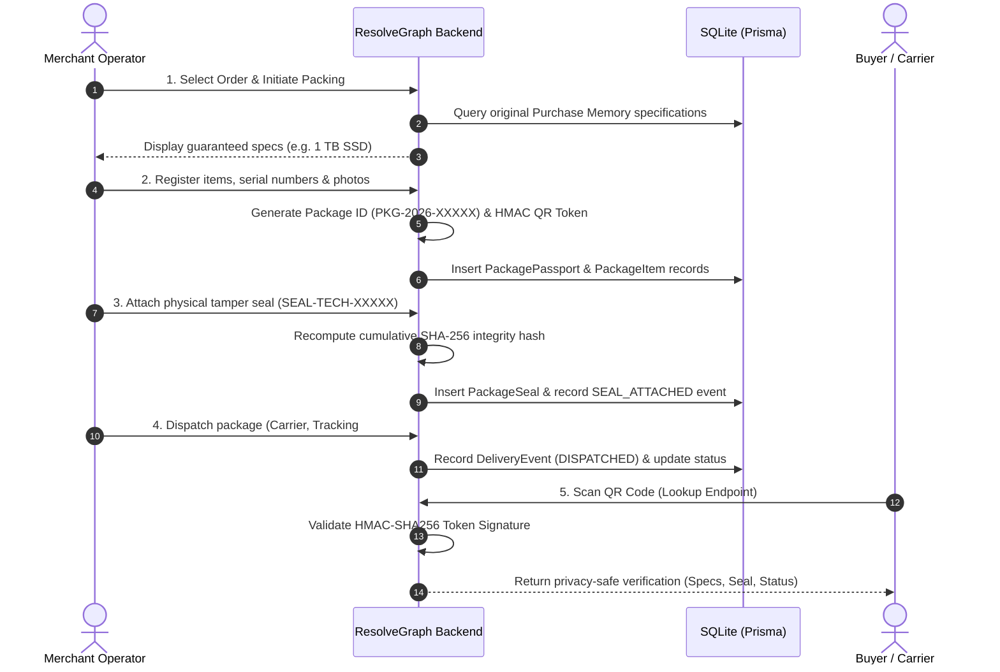

# 04. Package Passport Implementation

**Project:** RESOLVEGRAPH Version 2.0  
**Module:** Module 08 (Package Passport System)  
**Lead Architect:** Principal Software Architect & Lead Full-Stack Engineer  
**Date:** November 7, 2026  
**Status:** **IMPLEMENTATION COMPLETE (BUILT FROM THE GROUND UP)**

---

## 1. Executive Summary

This report documents the architectural design, database modeling, cryptographic token signing, and testing of **Module 08: Package Passport System**.

In traditional e-commerce, the physical packing of goods is a blind spot: merchants claim items were packed correctly, while buyers claim packages arrived damaged, missing, or swapped. 

RESOLVEGRAPH Version 2.0 introduces the **Package Passport**, creating an immutable pre-dispatch chain of custody that binds serialized product items, tamper-evident physical seals, packing photographs/videos, and carrier handoffs to a cryptographically verifiable QR code.

---

## 2. Package Passport Workflow & Lifecycle



---

## 3. Cryptographic QR-Code Security

A common vulnerability in physical QR labels is forgery or unauthorized exposure of buyer data. Module 08 enforces strict security invariants:

1. **HMAC-SHA256 Token Signing:**
   Tokens are constructed as:
   $$\text{Token} = \text{packageNumber} \,.\, \text{rawNonce} \,.\, \text{HMAC-SHA256}(\text{packageNumber} : \text{rawNonce}, \text{Secret})$$
   Any modification of the package number or nonce invalidates the signature, immediately preventing forged QR stickers.
2. **Privacy-Safe Public Verification:**
   Public QR lookups via `GET /api/packages/verify/[token]` sanitize the returned data:
   - **Exposed:** Package status, carrier name, tracking number, product names, declared specifications, seal numbers, and tamper status.
   - **Strictly Blocked / Redacted:** Buyer physical delivery address, buyer phone number, buyer email, payment card references, and internal operational notes.

---

## 4. Physical Seal & Integrity Recalculation

When a physical tamper-evident seal (`TAMPER_EVIDENT_TAPE`, `HOLOGRAPHIC_LABEL`, `SECURITY_VOID_LABEL`) is attached, the system recomputes the package's cumulative integrity hash:

$$\text{IntegrityHash}_{t+1} = \text{SHA-256}(\text{IntegrityHash}_{t} : \text{sealNumber} : \text{sealType})$$

This creates an irreversible cryptographic hash chain. If a merchant replaces or alters seal records after creation, the hash chain breaks.

---

## 5. Automated Test Results

Executed via `npx tsx --test tests/package-passport.test.ts`:

```
▶ RESOLVEGRAPH Version 2.0: Package Passport Suite
  ✔ Module 08: registers Package Passport with unique ID, items, and signed QR token (107.48ms)
  ✔ Module 08: validates genuine signed QR token and rejects forged or tampered token (22.34ms)
  ✔ Module 08: privacy safety check — QR verification does NOT expose buyer PII (4.60ms)
  ✔ Module 08: attaches tamper-evident seal and updates cumulative integrity hash (340.69ms)
  ✔ Module 08: dispatches package and generates matching delivery transit event (31.84ms)
  ✔ Module 08: tenant isolation blocks cross-tenant package queries (7.87ms)
✔ RESOLVEGRAPH Version 2.0: Package Passport Suite (750.41ms)

ℹ tests 6
ℹ suites 1
ℹ pass 6
ℹ fail 0
```

---

## 6. API Route Handlers Implemented

| Endpoint | Method | Purpose | Access Control |
|:---|:---:|:---|:---:|
| `/api/packages` | `POST` | Creates a new Package Passport with items and QR token | Merchant / Admin |
| `/api/packages` | `GET` | Lists packages scoped by merchant organization | Merchant / Admin |
| `/api/packages/[id]` | `GET` | Retrieves full package detail with seals and timeline | Tenancy Scoped |
| `/api/packages/[id]/seal` | `POST` | Registers a physical security seal and updates integrity | Merchant / Admin |
| `/api/packages/[id]/dispatch` | `POST` | Dispatches package and emits delivery transit event | Merchant / Admin |
| `/api/packages/verify/[token]` | `GET` | Public / authenticated privacy-safe QR verification | Public / Authenticated |

---

## 7. Status Verdict

- **Module 08 (Package Passport):** **COMPLETED (BUILT FROM THE GROUND UP)**
