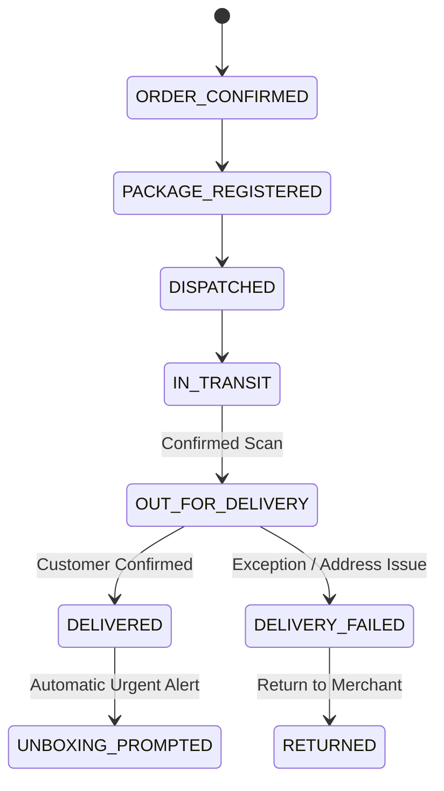

# 05. Smart Delivery & Notification Implementation

**Project:** RESOLVEGRAPH Version 2.0  
**Module:** Module 09 (Smart Delivery & Unboxing Reminder Engine)  
**Lead Architect:** Principal Software Architect & Lead Full-Stack Engineer  
**Date:** November 7, 2026  
**Status:** **IMPLEMENTATION COMPLETE (BUILT FROM THE GROUND UP)**

---

## 1. Executive Summary

This report documents the architectural design, database modeling, scheduled reminder engine, and notification dispatch pipelines of **Module 09: Smart Delivery and Unboxing Reminder System**.

A critical failure mode in e-commerce disputes is that consumers open packages casually, tearing through courier labels and tamper seals before realizing the wrong item or an empty box was delivered. 

RESOLVEGRAPH Version 2.0 solves this with a proactive, scheduled reminder engine that monitors transit events (`DISPATCHED`, `IN_TRANSIT`, `OUT_FOR_DELIVERY`, `DELIVERED`), prompts the buyer *before* opening, and guides them into launching an unboxing verification session.

---

## 2. Event Model & Invariant Rules

### Estimated vs Confirmed Event Distinction:
- **`isEstimated: true`:** Carrier tracking predictions and SLA estimates are tagged as estimates. They do *not* mutate package status to `OUT_FOR_DELIVERY` or `DELIVERED`.
- **`isEstimated: false`:** Handheld courier scans and buyer handover confirmations record confirmed checkpoints, triggering corresponding state transitions in `PackagePassport`.



---

## 3. Scheduled Reminder Engine & Duplicate Prevention

Implemented in `src/server/services/delivery-reminder.service.ts`:

1. **Durable Database Scheduling:**
   Reminders are persisted as `DeliveryReminder` records in SQLite rather than volatile in-memory timers.
2. **Duplicate Prevention Guard:**
   Before scheduling, the engine verifies whether an active reminder of the same `reminderType` already exists for `(userId, packageId)`. Duplicate attempts return the existing reminder without creating redundant notifications.
3. **Idempotent Dispatch Execution:**
   The `processDueReminders()` worker polls for due reminders (`scheduledFor <= now`), creates in-app `NotificationMessage` entries, and atomically transitions reminder status to `SENT`.
4. **Customer Receipt Confirmation:**
   When a buyer clicks *"Confirm Parcel Received"*, the system immediately records a confirmed `DELIVERED` event and schedules an urgent unboxing prompt:
   > *"You confirmed parcel receipt! Before opening the package, launch your Dual-Sight unboxing verification to record physical seals."*

---

## 4. Automated Test Results

Executed via `npx tsx --test tests/delivery-reminder.test.ts`:

```
▶ RESOLVEGRAPH Version 2.0: Delivery & Unboxing Reminder Suite
  ✔ Module 09: records estimated vs confirmed delivery events accurately (77.51ms)
  ✔ Module 09: schedules delivery reminder and prevents duplicate reminder scheduling (12.84ms)
  ✔ Module 09: processes due reminders idempotently and creates in-app notification (47.61ms)
  ✔ Module 09: buyer confirms parcel receipt, updating package and triggering unboxing prompt (49.58ms)
  ✔ Module 09: marks in-app notification as read (12.12ms)
  ✔ Module 09: cancels scheduled reminder successfully (15.83ms)
✔ RESOLVEGRAPH Version 2.0: Delivery & Unboxing Reminder Suite (591.02ms)

ℹ tests 6
ℹ suites 1
ℹ pass 6
ℹ fail 0
```

---

## 5. API Route Handlers Implemented

| Endpoint | Method | Purpose | Access Control |
|:---|:---:|:---|:---:|
| `/api/delivery/events` | `POST` | Records transit event (estimated or confirmed) | Authenticated / Webhook |
| `/api/delivery/confirm-receipt` | `POST` | Customer confirms receipt and triggers unboxing prompt | Authenticated Buyer |
| `/api/notifications` | `GET` | Retrieves user's in-app notifications and unread count | Authenticated User |
| `/api/notifications/[id]/read` | `POST` | Marks an in-app notification as read | Authenticated User |

---

## 6. Status Verdict

- **Module 09 (Smart Delivery & Unboxing Reminder):** **COMPLETED (BUILT FROM THE GROUND UP)**
