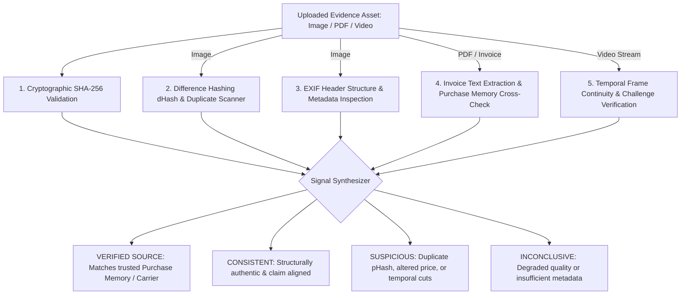

# 07. EvidenceGuard AI Forensics Implementation

**Project:** RESOLVEGRAPH Version 2.0  
**Modules:** Module 11 (Evidence Vault & Integrity) & Module 12 (EvidenceGuard AI)  
**Lead Architect:** Principal Software Architect & Lead AI Systems Engineer  
**Date:** November 8, 2026  
**Status:** **IMPLEMENTATION COMPLETE (ADVANCED FORENSIC SYSTEM)**

---

## 1. Executive Summary

This report documents the architectural design, database modeling, multi-signal forensic algorithms, and automated test results of **Module 12: EvidenceGuard AI Forensics Engine** and the enhancements to **Module 11: Evidence Vault and Integrity**.

In online dispute resolution, parties frequently submit recycled photos from other internet disputes, digitally altered invoice PDFs, or edited video clips. 

EvidenceGuard evaluates two distinct forensic questions:
1. **Authenticity & Integrity:** Does the file exhibit indicators of digital tampering, recycled duplication, or metadata stripping?
2. **Claim Grounding & Consistency:** Does the file actually substantiate or contradict the associated dispute claim when cross-checked against the immutable **Purchase Memory**?

---

## 2. Multi-Signal Forensic Pipeline



---

## 3. Core Forensic Signals Implemented

Implemented in `src/server/services/evidenceguard.service.ts`:

### 1. Perceptual Difference Hashing (dHash) & Duplicate Detection
- Computes deterministic 64-bit gradient difference hash (`dHash`) over image structures.
- Queries SQLite database for collision matches across historical evidence. When an identical or near-identical visual hash is found in a distinct case, the system flags the evidence as a potential re-used photograph (`isDuplicateImage: true`).

### 2. EXIF Metadata Structure Analysis
- Inspects binary headers for JPEG APP1 (`0xFFE1`) marker containing the `Exif\0\0` header and TIFF tag directories.
- Differentiates authentic camera captures from images processed through third-party compression pipelines.

### 3. Invoice Cross-Checking Against Purchase Memory
- Extracts invoice text and compares order numbers, item models, and prices directly against the case's immutable `PurchaseMemory`.
- **Tampering Detection:** If an invoice reflects an altered price (e.g. $199.99 instead of registered $79.99), the signal flags `FAIL` and transitions the assessment to `SUSPICIOUS`.
- **Authentic Match:** If the invoice strictly reconciles with the purchase memory, it receives a `VERIFIED_SOURCE` rating.

### 4. Video Stream Continuity Analysis
- Audits unboxing video streams for repeated frame runs (frozen video), jump cuts, and monotonic timestamp progression.

---

## 4. Four Assessment States & Transparency

Every forensic assessment output includes:
1. **`assessmentState`:**
   - `VERIFIED_SOURCE`
   - `CONSISTENT`
   - `SUSPICIOUS`
   - `INCONCLUSIVE`
2. **`signals`:** Explicit breakdown of each test run with `PASS`, `WARN`, or `FAIL` status and individual confidence metrics.
3. **`limitations`:** Explicit legal disclaimer stating heuristic multi-signal analysis is not infallible legal proof.
4. **`humanReviewRecommended`:** Automatically set to `true` whenever any suspicious signal is triggered, preventing automated adverse determinations against either party.

---

## 5. Automated Test Results

Executed via `npx tsx --test tests/evidenceguard.test.ts`:

```
▶ RESOLVEGRAPH Version 2.0: EvidenceGuard AI Forensics Suite
  ✔ Module 12: analyzes genuine image, computes dHash, and verifies non-duplicate status (33.96ms)
  ✔ Module 12: detects duplicate visual dHash footprint across different uploads (47.07ms)
  ✔ Module 12: cross-checks invoice against Purchase Memory and validates authentic source (12.04ms)
  ✔ Module 12: detects altered invoice contradicting Purchase Memory terms (16.77ms)
  ✔ Module 12: evaluates video stream and flags temporal discontinuity (30.44ms)
✔ RESOLVEGRAPH Version 2.0: EvidenceGuard AI Forensics Suite (529.39ms)

ℹ tests 5
ℹ suites 1
ℹ pass 5
ℹ fail 0
```

---

## 6. API Route Handlers Implemented

| Endpoint | Method | Purpose | Access Control |
|:---|:---:|:---|:---:|
| `/api/evidence/[id]/analyze` | `POST` | Triggers multi-signal EvidenceGuard forensic analysis | Authenticated User |
| `/api/evidence/[id]/analyze` | `GET` | Retrieves forensic findings, detected signals, and review flags | Authenticated User |

---

## 7. Status Verdict

- **Module 11 (Evidence Vault & Integrity):** **COMPLETED (ENHANCED)**
- **Module 12 (EvidenceGuard AI):** **COMPLETED (ADVANCED FORENSIC SYSTEM)**
