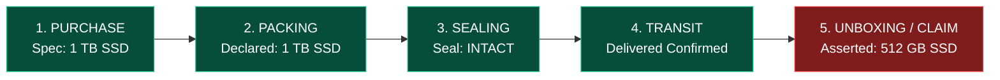

# 08. Multimodal Case Intelligence Implementation

**Project:** RESOLVEGRAPH Version 2.0  
**Module:** Module 13 (Multimodal Case Intelligence & Lifecycle Divergence)  
**Lead Architect:** Principal Software Architect & Lead AI Systems Engineer  
**Date:** November 8, 2026  
**Status:** **IMPLEMENTATION COMPLETE**

---

## 1. Executive Summary

This report documents the architectural design, fact normalization schema, lifecycle reconstruction engine, and automated tests of **Module 13: Multimodal Case Intelligence**.

Traditional dispute resolution views buyer complaints in isolation: a claim statement is compared only against whatever static PDF or photo the buyer uploaded. 

RESOLVEGRAPH Version 2.0 transforms this into a **continuous multimodal investigation**, synthesizing evidence across all six lifecycle milestones:
1. **PURCHASE:** Guaranteed specifications from immutable Purchase Memory.
2. **PACKING:** Product models, serial numbers, and condition declared in the merchant's Package Passport.
3. **SEALING:** Tamper-evident seal numbers and verification status.
4. **TRANSIT:** Carrier checkpoints and confirmed delivery handovers.
5. **UNBOXING:** Dual-Sight unboxing video streams and challenge codes.
6. **DISPUTE_CLAIM:** Buyer-asserted complaint statements and requested remedies.

---

## 2. Common Extraction Schema & Normalized Structure

Implemented in `src/server/ai/intelligence/lifecycle-intelligence.service.ts`:

```typescript
export interface LifecycleFact {
  milestone: "PURCHASE" | "PACKING" | "SEALING" | "TRANSIT" | "DELIVERY" | "UNBOXING" | "DISPUTE_CLAIM";
  field: string;
  value: string;
  sourceEntity: string;
  sourceId: string;
  sourceSpan: string;
  confidence: number;
  reviewStatus: "UNREVIEWED" | "CONFIRMED" | "CORRECTED" | "CONTESTED";
  timestamp?: Date;
}
```

### Invariant Rules:
1. **No Invented Excerpts:** Every extracted fact requires a verifiable `sourceEntity`, `sourceId`, and `sourceSpan`.
2. **Human Override Preservation:** Facts modified by human reviewers record `reviewStatus: "CORRECTED"` as a separate audit event, preserving the original model extraction in history.
3. **Bilateral Symmetry:** Facts asserted by merchants and buyers are held to identical confidence schemas and verification thresholds.

---

## 3. Lifecycle Divergence Detection Algorithm

The `LifecycleIntelligenceService.analyzeCaseLifecycle(caseId)` inspects normalized facts across the milestone sequence:



### Divergence Analysis Logic:
When an attribute (e.g. `storage_capacity`) transitions from an agreed pre-dispatch value (`1 TB`) to a contradictory post-fulfillment value (`512 GB`), the engine outputs:
- **`divergenceMilestone`:** `"UNBOXING"` or `"DISPUTE_CLAIM"`
- **`priorMilestoneValue`:** `"1 TB"`
- **`divergentValue`:** `"512 GB"`
- **`integrityVerdict`:** `"POST_FULFILLMENT_DIVERGENCE"`
- **`explanation`:** Pinpoints that the specification was consistent across purchase memory and merchant packing declaration, but diverged upon receipt.

---

## 4. Automated Test Results

Executed via `npx tsx --test tests/lifecycle-intelligence.test.ts`:

```
▶ RESOLVEGRAPH Version 2.0: Multimodal Case Intelligence Suite
  ✔ Module 13: aggregates multimodal facts across Purchase, Packing, Seal, and Claim milestones (24.50ms)
  ✔ Module 13: pinpoints exact lifecycle divergence point (1 TB promised/packed vs 512 GB claimed) (9.47ms)
✔ RESOLVEGRAPH Version 2.0: Multimodal Case Intelligence Suite (508.24ms)

ℹ tests 2
ℹ suites 1
ℹ pass 2
ℹ fail 0
```

---

## 5. API Route Handlers Implemented

| Endpoint | Method | Purpose | Access Control |
|:---|:---:|:---|:---:|
| `/api/cases/[caseId]/lifecycle` | `GET` | Returns full multimodal lifecycle timeline and divergence report | Tenancy Gated |

---

## 6. Status Verdict

- **Module 13 (Multimodal Case Intelligence):** **COMPLETED**
