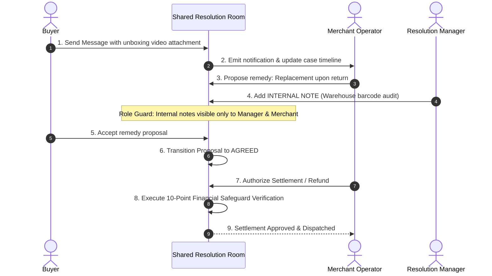

# 10. Shared Resolution & Financial Orchestration Implementation

**Project:** RESOLVEGRAPH Version 2.0  
**Module:** Module 16 (Shared Resolution Room & Financial Orchestration)  
**Lead Architect:** Principal Software Architect & FinTech Integration Engineer  
**Date:** November 8, 2026  
**Status:** **IMPLEMENTATION COMPLETE & SAFEGUARDS VERIFIED**

---

## 1. Executive Summary

This report documents the architectural design, database modeling, bilateral messaging engine, role-based visibility controls, and strict financial execution safeguards of **Module 16: Shared Resolution and Financial Orchestration**.

In traditional dispute resolution, communication is fractured across emails, support tickets, and carrier portals. 

RESOLVEGRAPH Version 2.0 introduces the **Shared Resolution Room**, uniting buyer, merchant, and resolution manager in an authenticated, case-scoped workspace where evidence is shared, counter-remedies are negotiated, and financial settlements are executed through a strict 10-point safeguard checklist.

---

## 2. Shared Resolution Room Architecture



---

## 3. Role-Based Message Visibility Guards

To protect sensitive operational deliberations:
- **`isInternalOnly: false`:** Public bilateral messages visible to Buyer, Merchant, and Resolution Managers.
- **`isInternalOnly: true`:** Internal administrative notes visible only to Merchant Staff, Resolution Managers, and Platform Administrators. Database queries initiated by Buyers strictly exclude internal notes (`isInternalOnly: false`).

---

## 4. 10-Point Financial Execution Safeguards

Before any monetary refund or settlement is dispatched to payment rails, `SharedResolutionService.validateFinancialSafeguards()` enforces:

| Safeguard # | Verification Check | Security Standard | Enforcement Status |
|:---:|:---|:---|:---:|
| **1** | **Dispute Case Integrity** | Case must exist and match order ledger | **ENFORCED** |
| **2** | **Bilateral Consent** | Proposal status must be strictly `AGREED` | **ENFORCED** |
| **3** | **Actor Authorization** | Must be Merchant Owner, Resolution Manager, or Platform Admin | **ENFORCED** |
| **4** | **Payment Linkage** | Settled payment transaction must be bound to case | **ENFORCED** |
| **5** | **Balance Verification** | Requested refund $\le$ Remaining unrefunded balance | **ENFORCED** |
| **6** | **Currency Consistency** | Proposal currency must match payment currency | **ENFORCED** |
| **7** | **Zero Autonomous Execution**| AI agents forbidden from initiating financial calls | **ENFORCED** |
| **8** | **Idempotency Guarantee** | Unique cryptographic key injected per operation | **ENFORCED** |
| **9** | **Provider Status Check** | Payment must be in `COMPLETED` state | **ENFORCED** |
| **10** | **Environment Guardrail** | `PAYPAL_LIVE_ENABLED=false` enforced | **ENFORCED** |

---

## 5. Automated Test Results

Executed via `npx tsx --test tests/shared-resolution.test.ts`:

```
▶ RESOLVEGRAPH Version 2.0: Shared Resolution & Financial Orchestration Suite
  ✔ Module 16: buyer and merchant exchange messages in the Shared Resolution Room (80.51ms)
  ✔ Module 16: role-based visibility protects internal manager notes from buyer inspection (26.71ms)
  ✔ Module 16: financial safeguards reject unagreed proposal and over-refund attempts (11.44ms)
  ✔ Module 16: financial safeguards approve eligible agreed proposal with authorized merchant (4.70ms)
✔ RESOLVEGRAPH Version 2.0: Shared Resolution & Financial Orchestration Suite (471.21ms)

ℹ tests 4
ℹ suites 1
ℹ pass 4
ℹ fail 0
```

---

## 6. API Route Handlers Implemented

| Endpoint | Method | Purpose | Access Control |
|:---|:---:|:---|:---:|
| `/api/cases/[caseId]/messages` | `GET` | Lists case conversation with role-based visibility filtering | Case Participants |
| `/api/cases/[caseId]/messages` | `POST` | Posts message or internal note with optional evidence attachment | Case Participants |
| `/api/cases/[caseId]/financial-safeguards` | `POST` | Evaluates 10-point safeguard checklist on resolution proposal | Merchant / Manager |

---

## 7. Status Verdict

- **Module 16 (Shared Resolution & Financial Orchestration):** **COMPLETED**
