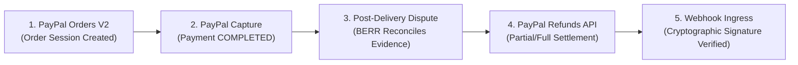

# PayPal Integration & Fintech Architecture

## 1. Role of PayPal in ResolveGraph
PayPal is the core financial and dispute synchronization rail powering ResolveGraph's end-to-end commerce lifecycle. Rather than treating payment gateways as separate siloes, ResolveGraph integrates directly with PayPal Sandbox APIs to connect upfront purchases with downstream dispute resolution:

---

## 2. Granular PayPal API Endpoints Utilized

| PayPal API Service | Endpoint | Usage in ResolveGraph |
|---|---|---|
| **OAuth 2.0 Auth** | `POST /v1/oauth2/token` | Ephemeral bearer token management with single-flight caching. |
| **Orders V2** | `POST /v2/checkout/orders` | Initializes checkout session with exact minor currency units. |
| **Payment Capture** | `POST /v2/checkout/orders/{id}/capture` | Captures funds, records PayPal Capture ID and fee deductions. |
| **Refunds API** | `POST /v2/payments/captures/{id}/refund` | Dispatches partial or full refunds with `PayPal-Request-Id` idempotency. |
| **Customer Disputes** | `GET /v1/customer/disputes` | Ingests active disputes; compiles and submits evidence dossiers. |
| **Webhook Verify** | `POST /v1/notifications/verify-webhook-signature` | Cryptographic signature validation with SSRF cert URL protection. |

---

## 3. Financial Integrity & Security Controls
1. **Idempotency Locking**: Every refund request incorporates a deterministic SHA-256 idempotency key (`reso-ref-{proposalId}`) in the `PayPal-Request-Id` header, eliminating risk of double-debiting during network retries.
2. **Partial Refund Accounting**: Tracks cumulative `refundedMinor` balances against the original capture amount, blocking any refund exceeding the available balance.
3. **Hardcoded Live Safeguards**: Live financial transactions (`PAYPAL_LIVE_ENABLED=false`) are strictly barred in all non-production environments by `FeatureFlags` and startup `EnvValidator`.
